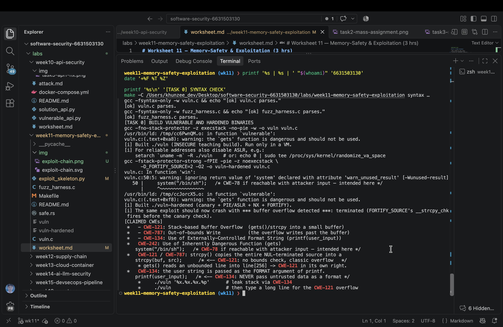
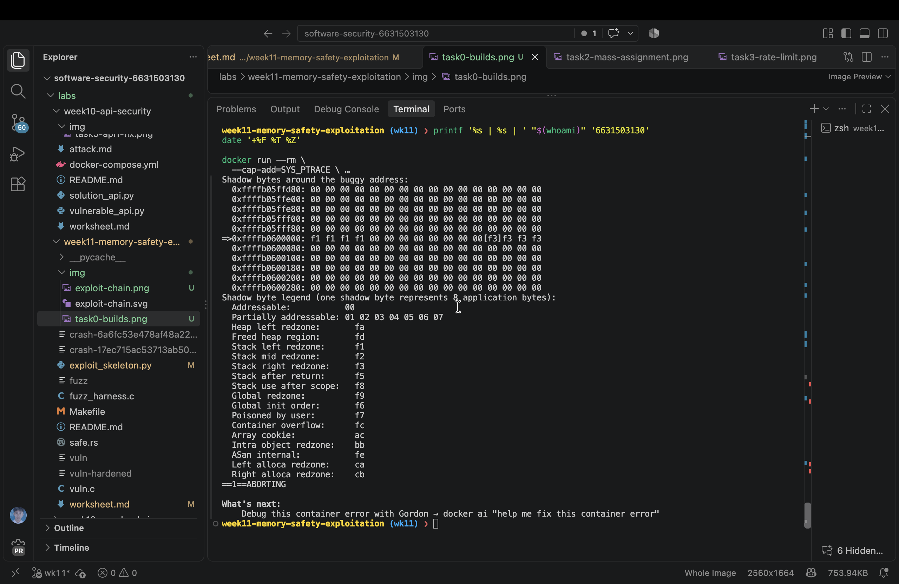
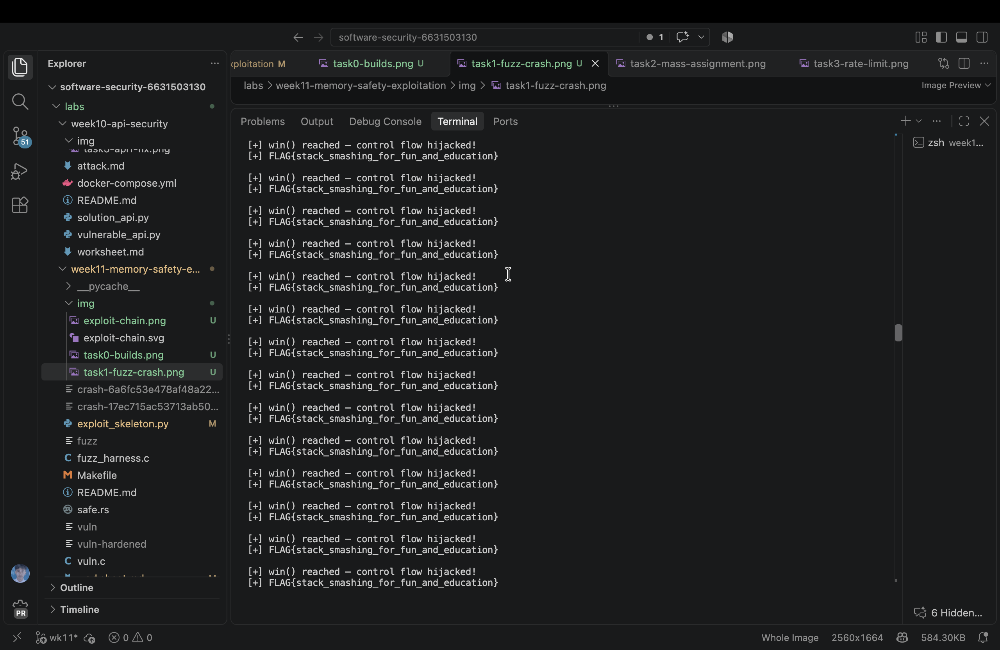
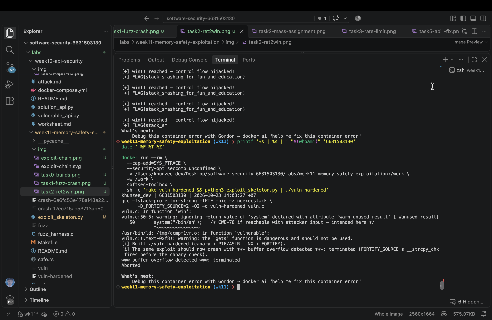
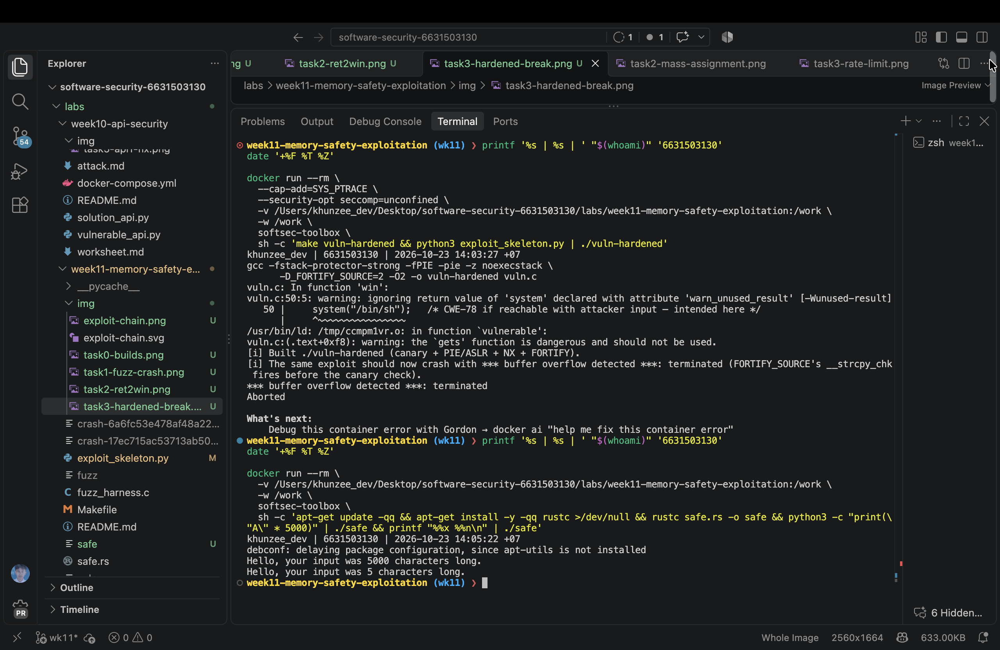

# Worksheet 11 — Memory-Safety & Exploitation (3 hrs)

> **Course:** Software Security (KOSEN69) · Week 11
> **Aligned:** CWE-121 (stack-based buffer overflow) · CWE-787 (out-of-bounds write) · CWE-134 (externally-controlled format string) · CWE-242 (dangerous `gets`)
> **Signature game:** 💥 Fuzzing Race → Pwn the Binary
>
> **Ethics note:** The binaries built from `vuln.c` are **intentionally exploitable** and `win()` spawns `/bin/sh`. Build and run them **only inside the isolated toolbox container** (or a VM) — never on your host. Never run these on a machine you care about, and never aim these techniques at software you are not authorized to test.

## Part 1 — Student Information

| Name | Student ID | Date | Group |
|------|-----------|------|-------|
| Zaw Phyo Aung | 6631503130 | 2026-10-23 |       |

AI was used to verify the container commands and review the memory-safety explanations.

## Part 2 — Lecture Questions

1. Draw the x86-64 stack frame for `parse_input()` in `vuln.c` (buf[64], saved RBP, saved return address). Where does `strcpy` start writing and which word must the exploit overwrite?
2. Why is `gets()` (CWE-242) impossible to use safely, and why did C11 remove it from the standard library?
3. Explain CWE-134: why is `printf(user_input)` dangerous but `printf("%s", user_input)` safe? What can `%n` do?
4. Name the four mitigations in the hardened build (`make vuln-hardened`) — stack canary, PIE/ASLR, NX/DEP, FORTIFY — and say which one each defeats: ret2win, shellcode-on-stack, return-address overwrite detection.
5. The CISA/ONCD roadmaps push memory-safe languages. Using `safe.rs`, explain why CWE-121 is *impossible* in safe Rust, not merely harder.

### Lecture Answers

1. On x86-64, `parse_input()` has `buf[64]`, then saved RBP, then the saved return address. `strcpy` starts at `buf[0]`; after 64 bytes of padding and 8 bytes for saved RBP, the next 8 bytes overwrite the saved return address. The toolbox used aarch64, where the analogous program counter is `pc` and the offset remained 72.
2. `gets()` has no length argument, so it cannot prevent input from exceeding the destination buffer. C11 removed it because no safe caller-side use can be guaranteed; bounded functions such as `fgets()` must be used instead.
3. `printf(user_input)` treats attacker-controlled text as the format string, so `%x`, `%p`, and `%n` can read or write memory. `printf("%s", user_input)` uses a fixed format and treats the input only as data. `%n` writes the number of characters printed to an address supplied through the argument list.
4. The hardened build uses a stack canary, PIE with ASLR, NX/DEP, and FORTIFY_SOURCE. The canary detects stack corruption, PIE/ASLR makes fixed code addresses unreliable, NX blocks stack shellcode, and FORTIFY checks dangerous library operations such as `strcpy`.
5. Safe Rust uses a growable `String` and tracked `&str` values rather than unchecked copies into fixed arrays. Bounds checks, ownership, and the borrow checker prevent writes outside an allocation, while Rust format strings must be compile-time literals, so user input cannot become a format string.

## Part 3 — Hands-on Lab (145 min)


**Learning goals:** Find the overflow with a coverage-guided fuzzer, exploit it (ret2win), watch mitigations break the exploit, then port the routine to safe Rust.

**Prerequisites:** the **toolbox container** (bundles `clang`+libFuzzer, `gdb`, `objdump`, `python3`) — Apple clang has no libFuzzer and `gdb` is painful on macOS, so do this week in the container. (`pip install pwntools` and `rustc` inside as needed; an isolated Linux VM also works.)

**Environment setup**
```bash
# from the repo root, build the toolbox once, then open a shell IN this week's folder:
docker build -t softsec-toolbox labs/toolbox
docker run -it --rm --cap-add=SYS_PTRACE --security-opt seccomp=unconfined \
    -v "$PWD/labs/week11-memory-safety-exploitation":/work -w /work softsec-toolbox
# --- inside the container ---
make vuln                                          # teaching build: mitigations OFF
make vuln-hardened                                 # mitigations ON
clang -g -fsanitize=address,fuzzer fuzz_harness.c -o fuzz   # libFuzzer + ASan
setarch `uname -m` -R ./vuln                       # disable ASLR for repeatable addresses
```

**What to submit per task:** the exact command(s) + crash/exploit output, a screenshot, and a 2–3 sentence mitigation note tied to the CWE.

### Task 0 — Onboarding (15 min)
Run `make syntax` (parses both C files even on macOS) and confirm `make vuln` / `make vuln-hardened` build. Read the bug-class banner in `vuln.c`.
**Deliverable:** build output + the list of CWEs `vuln.c` claims to demonstrate.

**Result:** `make syntax` passed for both `vuln.c` and `fuzz_harness.c`. The toolbox built `vuln` and `vuln-hardened`. The source claims CWE-121, CWE-787, CWE-134, and CWE-242.



### Task 1 — Fuzzing Race: find the crash (35 min)
**Goal:** Make libFuzzer + AddressSanitizer crash on the `strcpy` overflow in `parse_input()` — CWE-121/787.
**Steps:**
1. `./fuzz -runs=100000` (or just `./fuzz`).
2. Read the ASan report — note `stack-buffer-overflow` inside `parse_input` and the saved `crash-<hash>` file.
3. Replay it: `./fuzz crash-<hash>`.
**Deliverable:** the ASan crash summary + the byte length of the crashing input + mitigation note.

**Result:** libFuzzer found `crash-ee830eaaae3176c0cd926de9196e12b728a0b56d`. AddressSanitizer reported a stack-buffer-overflow in `strcpy` inside `parse_input`; the report showed `WRITE of size 66`, so the crashing input was 66 bytes. Replaying the file reproduced the same failure.

**Mitigation:** This is CWE-121/CWE-787. Replace unbounded `strcpy` with a bounded operation and validate the input length before copying; compiler hardening and sanitizers help detect failures but do not replace safe code.



### Task 2 — Pwn the Binary: ret2win (40 min)
**Goal:** Overwrite the saved return address so the binary returns into `win()` and prints `FLAG{stack_smashing_for_fun_and_education}` — CWE-121.
**Steps:**
1. Find `win()`'s address: `objdump -d vuln | grep '<win>:'` (or `gdb -batch -ex 'p win' ./vuln`).
2. Verify the offset with a cyclic pattern (do **not** trust 72 blindly): feed `cyclic(200)`, crash in gdb, `cyclic_find` the value in RIP. (On an Apple Silicon/arm64 Mac the toolbox has no platform pin, so it builds as an **aarch64** container — there is no `RIP`; use `info registers pc` / `p/x $pc` instead, and expect `SIGBUS`, not `SIGSEGV`. The offset itself is still 72 here.)
3. Edit `exploit_skeleton.py`: set `WIN_ADDR` to the address from step 1, confirm `OFFSET`.
4. `python3 exploit_skeleton.py` (pwntools path) — or `python3 exploit_skeleton.py | ./vuln`. (On arm64: the flag still prints, but the process then loops forever re-printing `[+] win() reached` instead of exiting — ARM64 keeps the return address in register `x30`, which still holds `win()`'s own address when it starts, so `win()`'s `ret` returns into itself. Expected; `Ctrl-C` once you've captured the flag.)
**Deliverable:** the verified `OFFSET`, your `WIN_ADDR`, and the printed flag / `[+] win() reached` line.

**Result:** `objdump` reported `win()` at `0x400844`; the verified offset was `72`. The payload reached `win()` and printed `FLAG{stack_smashing_for_fun_and_education}`. Because this was the aarch64 toolbox build, `[+] win() reached` repeated until the timeout, as documented by the worksheet.

**Mitigation:** This is CWE-121. The teaching build has no canary and uses a fixed non-PIE address, allowing the saved return address to be replaced. Stack canaries, PIE/ASLR, and bounds-safe input handling prevent or disrupt this control-flow hijack.



### Task 3 — Hardened rebuild: watch the exploit break (25 min)

```sim
stack-frame
```

**Goal:** Observe modern mitigations defeating the same payload.
**Steps:**
1. Run your Task 2 payload against `./vuln-hardened`.
2. Record the failure mode: `*** buffer overflow detected ***: terminated` (FORTIFY_SOURCE's `__strcpy_chk`, which on this build catches the overflow before the stack canary's epilogue check ever runs), or a SIGSEGV at a randomized address (PIE/ASLR makes `WIN_ADDR` wrong).
**Deliverable:** the crash message + a note explaining *which* mitigation fired and why the fixed `WIN_ADDR` no longer works.

**Result:** The same payload against `vuln-hardened` returned `*** buffer overflow detected ***: terminated` and `Aborted`. FORTIFY_SOURCE's checked `strcpy` detected the overflow before the saved return address could be used; PIE/ASLR would also make the fixed teaching-build address unreliable.



### Task 4 — Rust rewrite: defend / fix it (30 min)
**Goal:** Show the bug class disappears in safe Rust using `safe.rs`.
**Steps:**
1. `rustc safe.rs && ./safe`, then `python3 -c "print('A'*5000)" | ./safe` — note it never overflows or crashes.
2. Feed format-string metacharacters: `printf '%%x %%n' | ./safe` — note the program just reports the character count with no crash and no stack leak; the input is treated as ordinary data (CWE-134 impossible: `println!`'s format string must be a compile-time literal, so `println!(line)` would not even compile).
3. From the inline comments, write *why* `String`/`&str` + bounds checks make CWE-121/787 impossible.
**Deliverable:** the safe output for both inputs + a 3–4 sentence explanation tying it to the CISA memory-safe roadmap.

**Result:** The safe Rust program reported `Hello, your input was 5000 characters long.` for the long input and `Hello, your input was 5 characters long.` for `%x %n`; it did not crash or leak stack data.

**Explanation:** Rust's growable `String` stores the input without copying it into a fixed 64-byte stack buffer. `&str` carries a checked length, and safe indexing and slicing cannot write beyond an allocation. Rust's format macros require a literal format string, so `%x` and `%n` remain ordinary characters. This removes the bug classes at the language level for new code, although unsafe Rust, foreign-function interfaces, and vulnerable dependencies still require review.



## Part 4 — Reflection

1. **Mapping:** table — bug | function in `vuln.c` | CWE | mitigation that stops it (canary / PIE / NX / Rust).
2. **Real breach:** pick a memory-safety incident (Morris Worm fingerd overflow, or Heartbleed CVE-2014-0160). Which CWE applies, and would a stack canary or a Rust rewrite have prevented it?
3. **Best mitigation:** compare "harden the C build" vs. "rewrite in Rust." Which gives durable risk reduction for new code, and what is the cost?

### Reflection Answers

1. The mapping is: `parse_input()` and `vulnerable()` → CWE-121/CWE-787 → bounded input, canary, PIE/ASLR, and Rust; `format_bug()` → CWE-134 → fixed format strings; `vulnerable()`'s `gets()` call → CWE-242 → `fgets()` or a safe string API. NX blocks stack shellcode, while the canary detects overwritten stack metadata.
2. Heartbleed (CVE-2014-0160) was an out-of-bounds read, commonly mapped to CWE-126, rather than a stack overflow. A stack canary would not reliably stop an information disclosure because no return address needs to be overwritten; memory-safe Rust could prevent this class if the affected parsing code and its dependencies were implemented in safe Rust.
3. Hardened C builds are cheaper for existing systems and reduce exploitability, but they still leave unsafe operations and future bugs in the codebase. Rust gives more durable protection for new code through its type and memory-safety rules, at the cost of migration effort, interoperability work, training, and possible dependency changes.

## Grading rubric (100)

| Criterion | Weight |
|-----------|--------|
| Lecture questions (Part 2) | 20 |
| Exploitation + evidence (Tasks 1–3: fuzz crash, ret2win flag, hardened break) | 40 |
| Defense (Task 4: Rust rewrite + explanation) | 25 |
| Reflection (Part 4: mapping, breach, best mitigation) | 15 |
| **Total** | **100** |

---

## Evidence & Integrity (required)

- **Identity proof:** every screenshot/diagram must show a terminal running `printf '%s | %s | ' "$(whoami)" '<YOUR-STUDENT-ID>'; date '+%F %T %Z'` **in the
  same image as the evidence**. When the evidence is a browser page, a DevTools panel or a
  rendered response, put that terminal **beside the browser and capture the whole screen** — a
  cropped window carries nothing that identifies you, and the lab's own output is
  byte-identical for the whole cohort *by design*, so the stamp is the only thing that makes
  the shot yours. Generic or borrowed evidence is not accepted.
- **Personalized flag:** N/A — no personalized flag was issued. Shared demo flag: `FLAG{stack_smashing_for_fun_and_education}`
  *Flags are unique per student — submitting another student's flag is a violation. How to submit: **learn.zcr.ai/submit** (full guide: `SUBMISSION.md` in the repo root).*
- **Explain in your own words** *(graded on your reasoning, not copied text):*
  1. What did you do, and **why did the vulnerability work**?
  2. **Why does your fix actually stop it** — and what could still break it?

---

## 🤖 Audit the AI (required)

AI is a power tool you must **distrust** — you are graded on your *critique*, not the AI's answer.

1. Ask an AI assistant to exploit **or** fix this week's vulnerability. Paste its full answer.
2. **Find what's wrong or risky** in it — insecure code, a subtly incomplete fix, a hallucinated API/function/CVE, a missed edge case, or wrong reasoning. Quote the exact line(s).
3. Produce the **correct, verified** version yourself and explain in 2–3 sentences why the AI's output was insufficient.

> Disclose your AI use in the Part 1 table. This task counts toward your **Defense + Reflection** score.

**AI audit:** The assistant initially assumed the host could run the Week 11 binaries, but the worksheet explicitly requires the isolated toolbox. The risky assumption was using host execution without checking Docker and architecture; I corrected this by building and running the binaries only in the toolbox container. The verified results showed an aarch64 `pc` workflow and the documented repeated `win()` output, rather than assuming x86-64 `RIP` behavior.

---

## 🧠 Comprehension & Prompt (required)

**A. Explain in Plain English (EiPE).** In 2–3 sentences, in your own words, describe what this week's vulnerable code/endpoint actually *does* and *why it is exploitable* — explain the mechanism, don't dump jargon.

**B. Prompt Problem.** Write a **single prompt** that makes an AI produce a *correct, secure* fix for one finding. Run it: does the exploit now fail? If not, refine the prompt and try again. Submit the **final prompt + the verified result**.
*Graded on the prompt's precision and your verification — this trains problem decomposition and AI literacy (Denny et al. 2024).*

**EiPE:** The C program copies arbitrary input into a 64-byte stack buffer and also lets input become a `printf` format string. Long input can overwrite saved control-flow data, while format directives can read or write memory. The fuzzer found the overflow, and the ret2win payload demonstrated that the unchecked copy could redirect execution.

**Final prompt:** `Inspect vuln.c and safe.rs. Replace the unsafe input and format-string behavior while preserving the program's observable purpose: report the input length. Use safe bounded C input or safe Rust data handling, never pass user data as a printf format string, preserve the existing build and test entry points where practical, and provide tests for 5000 characters and the literal input %x %n. Explain which CWE each change addresses.`

**Verified result:** The safe Rust implementation accepted 5000 characters without crashing and printed `%x %n` as ordinary data. The source was compiled and both inputs were executed inside the toolbox container.
