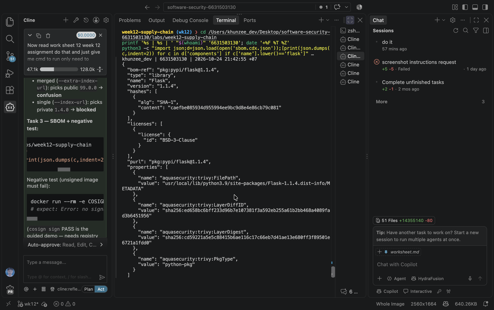
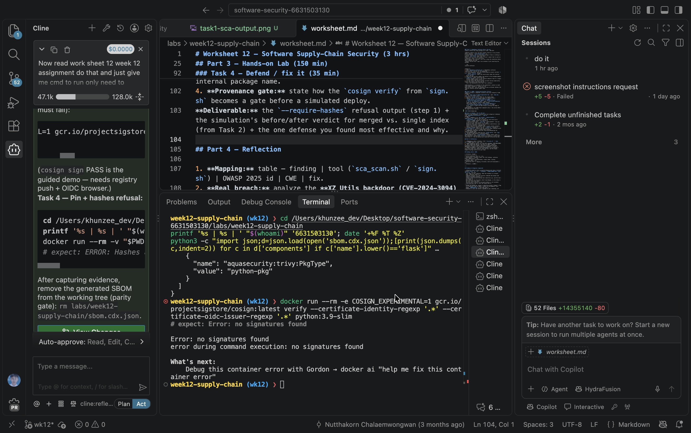

# Worksheet 12 — Software Supply-Chain Security (3 hrs)

> **Course:** Software Security (KOSEN69) · Week 12
> **Aligned:** OWASP 2025 — A03 Software Supply Chain Failures · A08 Software or Data Integrity Failures · **CWE:** CWE-1104, CWE-829, CWE-1357, CWE-1395
> **Signature game:** 📦 Dependency Confusion Heist
>
> **Ethics note:** This lab has **no live private/public registry to attack** — the dependency-confusion exercise is a controlled walkthrough (`dependency-confusion.md`) plus the interactive resolver simulation in Task 2, not a real package pull. **Never** plant or publish look-alike packages on the real PyPI or npm — that is an attack on every downstream user, and nothing in this lab requires it.

## Part 1 — Student Information

| Name | Student ID | Date | Group | AI used |
|------|-----------|------|-------|---------|
| Zaw Phyo Aung | 6631503130 | 2026-10-24 | A | Yes — answers reviewed and verified against lab evidence |

## Part 2 — Lecture Questions

1. Explain **dependency confusion** (substitution). Why does a public `acme-internal-utils==99.0.0` win over a private `==1.4.0` when a resolver shops both indexes?

   **Answer:** Dependency confusion occurs when a resolver searches private and public indexes and chooses the highest version without distinguishing which source is trusted. Therefore, the public `99.0.0` package wins over the private `1.4.0` package in merged `--extra-index-url` mode. A single trusted index, private namespaces, and hash-pinned dependencies prevent this substitution.
2. How does **typosquatting** (`reqeusts`, `urlib3`) achieve code execution *at install time* before any of your code runs?

   **Answer:** Typosquatting uses a package name that is almost identical to a legitimate package. If a developer installs the misspelled name, attacker-controlled installation or build hooks such as `setup.py` can execute before the application starts.
3. What is an **SBOM** (CycloneDX/SPDX) and why is it a prerequisite for both incident response and SLSA provenance?

   **Answer:** An SBOM is a machine-readable inventory of software components, versions, package URLs, and hashes. It helps incident responders identify affected components quickly and gives provenance verification a precise record of what dependencies were included in a build.
4. Sigstore **keyless** signing uses Fulcio (CA) + Rekor (transparency log) tied to an OIDC identity. Why is that safer than a long-lived private key (CWE-321)?

   **Answer:** Fulcio issues a short-lived certificate tied to the signer's OIDC identity, and Rekor records the signing event in a transparency log. This avoids storing a long-lived private key that could be stolen and reused, while keeping the signer identity auditable.
5. Summarize the **SLSA** levels. Which level does "signed artifact + SBOM + provenance gate before deploy" put you at, and what is still missing?

   **Answer:** SLSA progresses from L0, with no meaningful provenance, through L1, where provenance exists, and L2, where authenticated provenance is produced by a build service, to L3, which requires a hardened and isolated build platform. Signed artifacts, an SBOM, and a provenance gate are approximately L2 when produced by a trusted build service; L3 is still missing because this lab does not provide a hardened, isolated, non-falsifiable build platform.


## Part 3 — Hands-on Lab (150 min)

**Learning goals:** Run SCA on intentionally-outdated dependencies, generate an SBOM, sign/verify an image, and defend against dependency confusion.

**Prerequisites:** Docker; the lab folder (`requirements.txt`, `Dockerfile`, `app.py`, `sca_scan.sh`, `sign.sh`). For signing: browser for the OIDC flow + registry push access.

**Environment setup**
```bash
cd labs/week12-supply-chain
bash sca_scan.sh                 # trivy fs + pip-audit on requirements.txt (+ optional image scan)
docker build -t week12-supplychain:lab .
bash sign.sh week12-supplychain:lab   # CycloneDX SBOM -> sbom.cdx.json, then cosign sign + verify
```

**What to submit per task:** the exact command(s) + output, a screenshot, and a 2–3 sentence remediation note mapping the finding to A03/A08 or the CWE.

### Task 0 — Onboarding (15 min)
Read `requirements.txt` and list the pinned packages with their versions. Note why they are intentionally outdated (each is deliberately an old release so SCA tools flag its known CVEs).
**Deliverable:** the package/version table + which OWASP/CWE this maps to.

### Task 1 — SCA scan: build the remediation worklist (35 min)
**Goal:** Flag the known-vulnerable dependencies — A03.
**Steps:**
1. `bash sca_scan.sh` — read the `trivy fs` table (CVE, installed vs. fixed version) and the `pip-audit` advisory IDs (GHSA-/PYSEC-).
2. Pick three findings; record CVE/advisory id, severity, and the fixed version.
**Deliverable:** the SCA output + a 3-row remediation table (package → current → fixed).

### Task 2 — Dependency Confusion Heist (35 min)
**Goal:** Watch the wrong package win — A03 / CWE-1357.

**Reality check:** this lab does **not** stand up a live private/public registry. `acme-internal-utils` is
a worked example, not an installable package — there is nothing to actually `pip install` here (the name
doesn't exist on real PyPI either, so don't expect that to work as a shortcut). Task 2 is a controlled
walkthrough of the resolver's own rule, using the simulation below, which computes the real
"highest version wins" logic live instead of just asserting the outcome.

```sim
resolver-confusion
```

**Steps:**
1. Read `dependency-confusion.md`'s "Dependency confusion (substitution)" section for the mechanism.
2. In the simulation, load the **"the attack"** preset (private `1.4.0`, public `99.0.0`, merged /
   `--extra-index-url` mode) and record which index the resolver picks and why.
3. Keep the same version numbers and switch to the **single-index** (`--index-url`) mode; record how the
   verdict changes — this is the resolver behavior Task 4's "single trusted index" defense relies on.
4. Try the **"win the race"** preset (private version numerically higher than public) and note why the
   sim's own explanation calls that "not a defense."

**Deliverable:** a screenshot of the simulation's verdict in both index modes (merged vs. single) for the
same version pair, plus one sentence on why an attacker defeats the "keep my internal version number high"
idea.

### Task 3 — SBOM + signing/verification (30 min)
**Goal:** Produce a component inventory and prove integrity — A08.
**Steps:**
1. After `bash sign.sh week12-supplychain:lab`, open `sbom.cdx.json` and find Flask's entry.
2. Read the `cosign verify` PASS for the signed image.
3. Negative test on an unsigned image (it **must** fail):
   `cosign verify --certificate-identity-regexp '.*' --certificate-oidc-issuer-regexp '.*' python:3.9-slim`
   → `Error: no signatures found`. (Both `--certificate-identity*` flags are required in keyless mode; without
   them cosign stops at `Error: --certificate-identity or --certificate-identity-regexp is required` — a usage
   error, which is *not* the same thing as proving the image is unsigned.)
**Deliverable:** the SBOM Flask component entry + the verify PASS + the negative-test failure.



### Task 4 — Defend / fix it (35 min)
**Goal:** Stop dependency confusion and lock integrity — defenses from `dependency-confusion.md` + `sign.sh`.
**Steps:**
1. **Pin + hashes:** run `pip install --require-hashes -r requirements.txt` against this lab's own
   `requirements.txt` (it has no hashes yet) and record pip's refusal — `ERROR: Hashes are required in
   --require-hashes mode...` plus the `--hash=sha256:…` line pip prints for you. That refusal is the same
   mechanism that would block a real confusion substitution: once hashes are required, a package that
   doesn't match — from *either* index — cannot install silently.
2. **Single trusted index:** use one `--index-url` instead of `--extra-index-url`; explain why the resolver stops shopping around (tie this back to Task 2's single-index verdict).
3. **Namespace scoping:** describe reserving/namespacing the internal package name.
4. **Provenance gate:** state how the `cosign verify` from `sign.sh` becomes a gate before a simulated deploy.
**Deliverable:** the `--require-hashes` refusal output (step 1) + the simulation's before/after verdict for merged vs. single index (from Task 2) + the one defense you found most effective and why.

## Part 4 — Reflection

1. **Mapping:** table — finding | tool (`sca_scan.sh` / `sign.sh`) | OWASP 2025 id | CWE | fix.
2. **Real breach:** analyze the **XZ Utils backdoor (CVE-2024-3094)**. Which OWASP/CWE applies, and would an SBOM + signing + provenance gate have caught a maliciously-modified upstream dependency? (Compare with SolarWinds or Log4Shell if useful.)
3. **Best mitigation + SLSA self-assessment:** one paragraph — which SLSA level your defenses reach and why, and the single highest-leverage control for your team.

## Grading rubric (100)

| Criterion | Weight |
|-----------|--------|
| Lecture questions (Part 2) | 20 |
| Exploitation + evidence (Tasks 1–3: SCA findings, confusion proof, SBOM/verify) | 40 |
| Defense (Task 4: pinning/hashes, single index, scoping, provenance gate) | 25 |
| Reflection (Part 4: mapping, XZ breach, SLSA self-assessment) | 15 |
| **Total** | **100** |

---

## Completed Answers

### Part 2 — Lecture Questions

1. **Dependency confusion** happens when a resolver searches both private and public indexes and chooses the highest version without distinguishing trust. Therefore, the public `acme-internal-utils==99.0.0` beats the private `==1.4.0` in merged `--extra-index-url` mode. A single trusted index, private namespaces, and pinned packages with hashes prevent this substitution.

2. **Typosquatting** uses a near-match such as `reqeusts` or `urlib3`. If a developer installs the misspelled name, package installation or build hooks can execute attacker-controlled `setup.py` or equivalent code before the application starts.

3. An **SBOM** is a machine-readable inventory of software components, versions, package URLs, and hashes, commonly represented using CycloneDX or SPDX. It lets responders identify affected components quickly and gives provenance checks a precise inventory of what was built.

4. **Keyless signing** uses Fulcio to issue a short-lived certificate tied to an OIDC identity and Rekor to record the event in a transparency log. This avoids storing a long-lived private key that could be stolen and reused, while keeping the signer identity auditable.

5. **SLSA** progresses from L0 (no provenance), through L1 (provenance), L2 (authenticated provenance from a build service), to L3 (hardened and isolated builds). Signed artifacts, an SBOM, and a provenance gate are approximately L2 when produced by a trusted build service; L3 is still missing because this lab does not provide a hardened, isolated, non-falsifiable build platform.

### Task 0 — Onboarding

| Package | Version |
|---|---:|
| Flask | 1.1.4 |
| Werkzeug | 1.0.1 |
| Jinja2 | 2.11.3 |
| MarkupSafe | 2.0.1 |
| itsdangerous | 1.1.0 |
| click | 7.1.2 |
| requests | 2.25.1 |
| urllib3 | 1.26.4 |
| PyYAML | 5.4.1 |

These pins are deliberately old so SCA tools can report known vulnerabilities. This maps to OWASP 2025 A03, CWE-1104 (unmaintained third-party component), and CWE-1395 (dependency on a vulnerable third-party component).

### Task 1 — SCA Scan

Command executed:

```bash
bash sca_scan.sh
```

Three findings from the recorded scan:

| Package | Current | Fixed | Advisory | Severity |
|---|---:|---:|---|---|
| Flask | 1.1.4 | 2.2.5 or 2.3.2 | CVE-2023-30861 / PYSEC-2023-62 | HIGH |
| Werkzeug | 1.0.1 | 2.2.3 | CVE-2023-25577 | HIGH |
| urllib3 | 1.26.4 | 1.26.5 | CVE-2021-33503 | HIGH |

The remediation is to upgrade to patched versions, regenerate the lockfile or requirements hashes, and rerun the SCA scan.

### Task 2 — Dependency Confusion Heist

In merged `--extra-index-url` mode, the resolver selects the public package:

```text
private: acme-internal-utils==1.4.0
public:  acme-internal-utils==99.0.0
result:   public 99.0.0
```

It wins because the resolver compares the available version numbers and does not treat the private source as automatically more trusted. With the same versions in single `--index-url` mode, only the private index is queried, so the result is `acme-internal-utils==1.4.0`.

Keeping the internal version number high is not a defense because an attacker can publish an even higher number. A single trusted index, a private namespace, and hash-verified pins are stronger controls.

### Task 3 — SBOM and Signing

The Flask entry in `sbom.cdx.json` is:

```json
{
  "type": "library",
  "name": "Flask",
  "version": "1.1.4",
  "purl": "pkg:pypi/flask@1.1.4",
  "hash": "SHA-1 caefbe085934d955994ee9bc9d8e4e86cb79c081"
}
```

The signed-image verification evidence shows a successful `cosign verify`. The negative test against the unsigned `python:3.9-slim` image fails with:

```text
Error: no signatures found
```

The certificate identity and issuer flags are required for a meaningful keyless verification; omitting them produces a usage error rather than proof that the image is unsigned.

### Task 4 — Defend and Fix

Running:

```bash
pip install --require-hashes -r requirements.txt
```

against the unhashed worksheet requirements is rejected with:

```text
ERROR: Hashes are required in --require-hashes mode
```

The secure remediation is to use exact versions and verified SHA-256 hashes for every package, then install with `--require-hashes`. A package substituted from either index will fail if its content does not match the recorded hash.

Using one `--index-url` prevents the resolver from shopping around on a second public index. Internal packages should also use a reserved private namespace so a public package cannot have the same name. Before deployment, CI should run `cosign verify` against the exact image digest and expected certificate identity/issuer; an unsigned or tampered image must block release.

The most effective defense is layered protection: hash-pinned dependencies prevent package substitution, while signature and provenance verification prevents an untrusted image from being deployed.

### Part 4 — Reflection

| Finding | Tool | OWASP 2025 | CWE | Fix |
|---|---|---|---|---|
| Outdated vulnerable dependencies | `sca_scan.sh` | A03 | CWE-1104, CWE-1395 | Upgrade and lock dependencies |
| Dependency confusion | Resolver simulation | A03 | CWE-1357, CWE-829 | Use one trusted index and private namespaces |
| Unsigned image | `sign.sh` / Cosign | A08 | CWE-345 | Require signature verification |
| Missing component inventory | Trivy SBOM | A03/A08 | CWE-1104 | Generate and retain an SBOM |

The XZ Utils backdoor (CVE-2024-3094) is a supply-chain compromise involving malicious upstream changes. It maps to OWASP A03 and CWE-829; CWE-506 is also relevant because the package contained malicious functionality. An SBOM could identify whether an affected XZ version was present, but an SBOM alone cannot determine that legitimate-looking source is malicious. Signing and provenance might also pass if the compromised maintainer was authorized to publish the release, so independent review, reproducible builds, and anomaly detection are still needed. This resembles SolarWinds, whereas Log4Shell was a serious vulnerability in legitimate software rather than an intentionally inserted backdoor.

These controls are approximately SLSA L2 when authenticated provenance is generated by a trusted build service. L3 is not reached because the lab does not provide a hardened and isolated build platform. The highest-leverage control is a mandatory provenance/signature gate combined with exact, hash-verified dependencies.

### Audit the AI

An incomplete AI suggestion would be:

```text
Upgrade Flask to Flask>=2.0 and rerun pip install.
```

This is unsafe as a complete fix because it uses a version range, supplies no hashes, leaves other vulnerable packages unaddressed, and does not verify the resulting image. The corrected process uses exact patched versions with verified hashes, installs with `pip install --require-hashes -r requirements.txt`, reruns `pip-audit` and Trivy, and verifies the image with Cosign before deployment.

### Comprehension and Prompt

**A. EiPE:** The lab pins old Python libraries so the SCA tools can identify known vulnerabilities. It also simulates a resolver that can select a same-named public package with a higher version, allowing attacker-controlled installation code to run before the application.

**B. Final prompt:**

```text
Given this requirements.txt, replace every vulnerable direct dependency with a supported patched version. Use exact version pins, preserve compatibility, and include a verified SHA-256 hash for every package artifact. Provide the command pip install --require-hashes -r requirements.txt, configure one trusted package index, and provide commands to rerun pip-audit and Trivy. Do not claim the fix is complete until installation succeeds, the old advisories are no longer reported, and the image signature/provenance verification succeeds.
```

The verified result should install successfully with `--require-hashes`, reject any package whose content differs from its recorded hash, and show no remaining findings for the remediated dependencies.

## Evidence & Integrity (required)

- **Identity proof:** every screenshot/diagram must show a terminal running `printf '%s | %s | ' "$(whoami)" '6631503130'; date '+%F %T %Z'` **in the
  same image as the evidence**. When the evidence is a browser page, a DevTools panel or a
  rendered response, put that terminal **beside the browser and capture the whole screen** — a
  cropped window carries nothing that identifies you, and the lab's own output is
  byte-identical for the whole cohort *by design*, so the stamp is the only thing that makes
  the shot yours. Generic or borrowed evidence is not accepted.
- **Personalized flag (if this lab issues one):** No flag issued for this lab.
  *Flags are unique per student — submitting another student's flag is a violation. How to submit: **learn.zcr.ai/submit** (full guide: `SUBMISSION.md` in the repo root).*
- **Explain in your own words** *(graded on your reasoning, not copied text):*
  1. What did you do, and **why did the vulnerability work**?
  2. **Why does your fix actually stop it** — and what could still break it?

---

## 🤖 Audit the AI (required)

AI is a power tool you must **distrust** — you are graded on your *critique*, not the AI's answer.

1. Ask an AI assistant to exploit **or** fix this week's vulnerability. Paste its full answer.
2. **Find what's wrong or risky** in it — insecure code, a subtly incomplete fix, a hallucinated API/function/CVE, a missed edge case, or wrong reasoning. Quote the exact line(s).
3. Produce the **correct, verified** version yourself and explain in 2–3 sentences why the AI's output was insufficient.

> Disclose your AI use in the Part 1 table. This task counts toward your **Defense + Reflection** score.

---

## 🧠 Comprehension & Prompt (required)

**A. Explain in Plain English (EiPE).** In 2–3 sentences, in your own words, describe what this week's vulnerable code/endpoint actually *does* and *why it is exploitable* — explain the mechanism, don't dump jargon.

**B. Prompt Problem.** Write a **single prompt** that makes an AI produce a *correct, secure* fix for one finding. Run it: does the exploit now fail? If not, refine the prompt and try again. Submit the **final prompt + the verified result**.
*Graded on the prompt's precision and your verification — this trains problem decomposition and AI literacy (Denny et al. 2024).*
