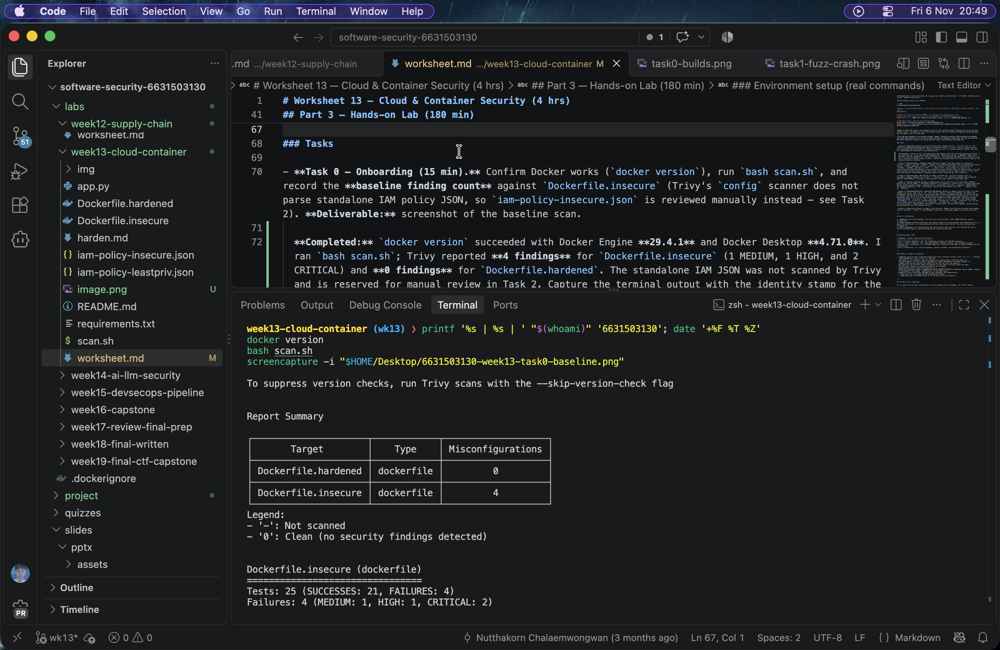
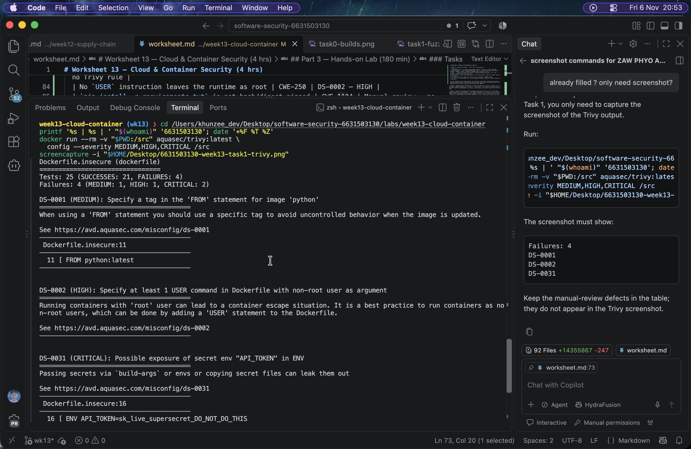
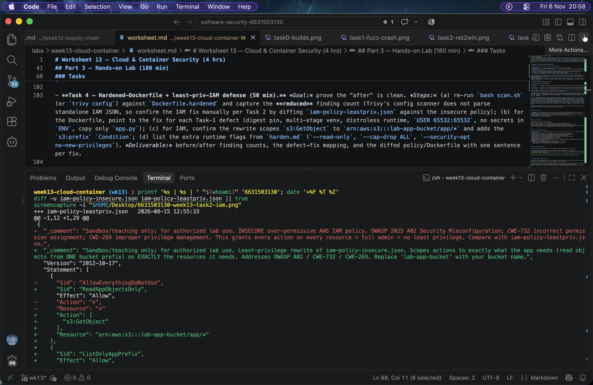
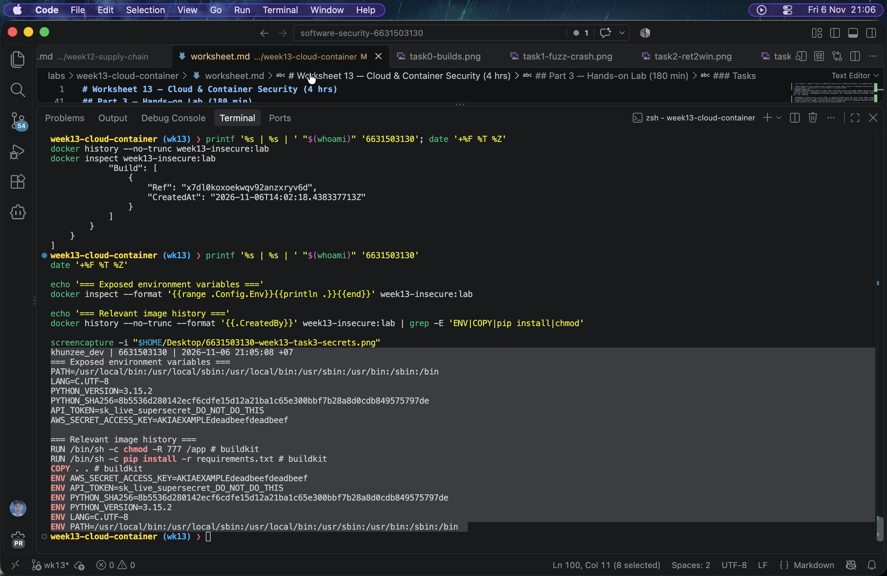
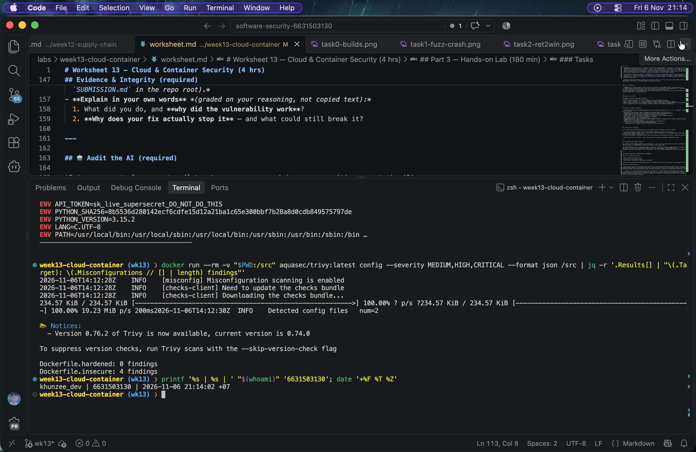

# Worksheet 13 — Cloud & Container Security (4 hrs)

> **Course:** Software Security (KOSEN69) · Week 13
> **Aligned to:** OWASP 2025 **A02 Security Misconfiguration** · **CWE-732** (incorrect permission assignment), **CWE-16** (configuration), plus CWE-798, CWE-250, CWE-538, CWE-269, CWE-1104
> **Signature game:** 🔍 *Misconfig Hunt* (CloudGoat-style) — each misconfig you find **and** fix = a flag.

> ⚠️ **Ethics note:** All artifacts here are deliberately broken for teaching and are marked *"Sandbox/teaching only; for authorized lab use."* Scan, exploit, and harden **only** these lab files (or systems you own / are authorized to test). Never point Trivy or these techniques at third-party cloud accounts or images without written permission.

---

## Part 1 — Student Information

| Name | Student ID | Date | Group |
|------|-----------|------|-------|
| ZAW PHYO AUNG | 6631503130 | 2026-11-06 | Individual |

---

## Part 2 — Lecture Questions

Answer in your own words (2–4 sentences each).

1. Explain the **shared-responsibility model**. In `harden.md` it says "the cloud provider secures *of* the cloud; you secure what you put *in* it." Give one concrete example of each side for an S3-backed app.

   **Answer:** The cloud provider secures the underlying infrastructure, including the physical data center, network, storage service, and managed-service platform. The customer secures what is placed in the service: for an S3-backed app, AWS protects the S3 service itself, while the customer must keep the bucket private, restrict the IAM role, and protect the objects and application credentials.
2. `iam-policy-insecure.json` uses `"Action": "*"` and `"Resource": "*"`. Describe **why this violates least privilege** and map it to CWE-732 vs CWE-269 — what is the difference between the two CWEs here?

   **Answer:** `"Action": "*"` allows every AWS operation and `"Resource": "*"` allows those operations against every resource, so a compromised identity has much more power than the application needs. CWE-269 describes improper privilege management, such as granting administrative actions; CWE-732 describes incorrect permission assignment to a resource, such as allowing access to every bucket instead of one required prefix. This policy has both problems.
3. The insecure Dockerfile bakes `ENV API_TOKEN=sk_live_...`. Explain how an attacker recovers that secret from a shipped image (name the `docker` commands) and why this is **CWE-798 / CWE-200**.

   **Answer:** An attacker who obtains the image can run `docker history --no-trunc IMAGE` and inspect the image configuration with `docker inspect IMAGE`; the `ENV` values can also remain in image layers and registry metadata. This exposes credentials to anyone who can pull or inspect the image, which is CWE-798 (hard-coded credentials) and CWE-200 (information exposure).
4. Why is `FROM python:latest` (CWE-1104/CWE-16) a security and reproducibility problem, and how does pinning to an `@sha256:` digest fix it?

   **Answer:** `python:latest` is mutable, so a later build can use a different interpreter or OS packages, including a vulnerable or incompatible version. Pinning an immutable `@sha256:` digest makes the build reproducible and ensures that the reviewed image bytes are the ones deployed; the digest still needs periodic security updates.
5. What does a **distroless** base image remove (relative to `python:3.11-slim`), and how does that shrink the attack surface for an RCE or container-escape attacker?

   **Answer:** A distroless image removes the shell, package manager, and most diagnostic utilities and unused OS components compared with `python:3.11-slim`. An attacker who reaches code execution has fewer tools and fewer packages to abuse, so the runtime attack surface and some escape paths are reduced; this does not replace patching, non-root execution, or runtime isolation.

---

## Part 3 — Hands-on Lab (180 min)

**Learning goals:** find cloud/container misconfigurations with Trivy, map each to a CWE, and rebuild the IAM policy + Dockerfile to least privilege / hardened so the findings drop.

**Prerequisites:** Docker installed and running; the `week13-cloud-container/` lab folder; internet access to pull `aquasec/trivy:latest`.

### Environment setup (real commands)

```bash
cd labs/week13-cloud-container

# Option A — the provided wrapper (trivy config over the Dockerfiles; IAM JSON is reviewed manually, see Task 2):
bash scan.sh

# Option B — run Trivy directly (MEDIUM is in the filter on purpose: one of the
# three rules Task 1 asks you to cite is rated MEDIUM, and HIGH,CRITICAL hides it):
docker run --rm -v "$PWD:/src" aquasec/trivy:latest config --severity MEDIUM,HIGH,CRITICAL /src

# (Optional) build + CVE-scan the hardened image:
docker build -f Dockerfile.hardened -t week13-hardened:lab .
docker run --rm -v /var/run/docker.sock:/var/run/docker.sock aquasec/trivy:latest image --severity HIGH,CRITICAL week13-hardened:lab
```

**What to submit per task:** the command(s) you ran + the relevant output (finding count or the specific finding line), a screenshot of the Trivy/terminal result, and a 2–3 sentence mitigation explaining *why* the fix reduces risk (cite the CWE).


### Tasks

- **Task 0 — Onboarding (15 min).** Confirm Docker works (`docker version`), run `bash scan.sh`, and record the **baseline finding count** against `Dockerfile.insecure` (Trivy's `config` scanner does not parse standalone IAM policy JSON, so `iam-policy-insecure.json` is reviewed manually instead — see Task 2). **Deliverable:** screenshot of the baseline scan.

  **Completed:** `docker version` succeeded with Docker Engine **29.4.1** and Docker Desktop **4.71.0**. I ran `bash scan.sh`; Trivy reported **4 findings** for `Dockerfile.insecure` (1 MEDIUM, 1 HIGH, and 2 CRITICAL) and **0 findings** for `Dockerfile.hardened`. The standalone IAM JSON was not scanned by Trivy and is reserved for manual review in Task 2. Capture the terminal output with the identity stamp for the required evidence screenshot.

- **Task 1 — Misconfig Hunt: container image (40 min).** *Goal:* find every defect in `Dockerfile.insecure`. *Steps:* read each `# DEFECT:` comment, then locate the matching Trivy finding where one exists — only 3 of the 6 (unpinned `:latest`, runs as root, secrets in `ENV`) map to a Trivy config rule (`DS-0001`, `DS-0002`, `DS-0031`); `COPY . .`, `chmod -R 777`, and unpinned `pip install` are instruction-level RUN/COPY semantics Trivy's Dockerfile scanner doesn't check, so identify those 3 by code review instead. Build a table: defect → CWE → Trivy rule/severity (write "manual review — no Trivy rule" where none exists). *Deliverable:* completed table (6 rows) using the IDs from `harden.md`.

  **Completed — container misconfiguration table:**

  | Defect in `Dockerfile.insecure` | CWE | Trivy rule/severity |
  |---|---|---|
  | `FROM python:latest` is mutable and unpinned | CWE-1104 / CWE-16 | DS-0001 — MEDIUM |
  | `ENV API_TOKEN=...` and `ENV AWS_SECRET_ACCESS_KEY=...` bake secrets into image layers | CWE-798 / CWE-200 / CWE-16 | DS-0031 — CRITICAL (one finding per secret) |
  | `COPY . .` copies the whole build context, including possible keys and `.env` files | CWE-538 | Manual review — no Trivy rule |
  | `RUN chmod -R 777 /app` makes application files world-writable | CWE-732 | Manual review — no Trivy rule |
  | No `USER` instruction leaves the runtime as root | CWE-250 | DS-0002 — HIGH |
  | `pip install -r requirements.txt` is not hash/digest pinned | CWE-1104 | Manual review — no Trivy rule |

  The scan produced four findings because the two secret environment variables each produce a separate DS-0031 finding. The remaining three defects require code review because this Trivy Dockerfile scan does not flag those instruction-level semantics.

- **Task 2 — Misconfig Hunt: IAM (30 min).** *Goal:* document why `iam-policy-insecure.json` is full-admin. *Steps:* identify the `Action:*` / `Resource:*` / no-`Condition` problems; map to CWE-269 / CWE-732. *Deliverable:* 3-row table + one sentence on the blast radius if these creds leak.

  **Completed — IAM misconfiguration table:**

  | Problem | CWE | Why it is dangerous |
  |---|---|---|
  | `"Action": "*"` | CWE-269 | The identity can perform unrelated administrative operations, not only the read operation needed by the app. |
  | `"Resource": "*"` | CWE-732 | Even an allowed action applies to every resource instead of one bucket and prefix. |
  | No `Condition` | CWE-732 | There is no additional scope such as an allowed S3 key prefix, so accidental access is easier. |

  **Blast radius:** If these credentials leak, an attacker can read, modify, delete, or reconfigure essentially any AWS resource permitted to that identity, causing data loss, service takeover, and expensive abuse.

- **Task 3 — Secrets & storage (25 min).** *Goal:* show secrets must not live in the image. *Steps:* explain how `ENV API_TOKEN` / `AWS_SECRET_ACCESS_KEY` are exposed via `docker history`; propose where they belong instead (secrets manager / mounted secret / orchestrator secret per `harden.md`). *Deliverable:* 2–3 sentence remediation + the `.dockerignore` entries you would add to stop `COPY . .` leaking `.git`/`.env` (CWE-538).

  **Completed:** `docker history --no-trunc IMAGE` can reveal the Dockerfile and `ENV` values, while `docker inspect IMAGE` exposes environment configuration; image layers and registry metadata may also preserve the values. Secrets should be supplied only at runtime through a cloud secrets manager, an orchestrator secret, or a mounted secret file, and exposed credentials should be rotated. This avoids baking credentials into a shipped image and reduces CWE-798/CWE-200 risk.

  Recommended `.dockerignore` entries to reduce CWE-538 leakage from `COPY . .`:

  ```text
  .git
  .git/**
  .env
  .env.*
  *.pem
  *.key
  *.crt
  secrets/
  ```

- **Task 4 — Hardened-Dockerfile + least-priv-IAM defense (50 min).** *Goal:* prove the "after" is clean. *Steps:* (a) re-run `bash scan.sh` (or `trivy config`) against `Dockerfile.hardened` and capture the **reduced** finding count (Trivy's config scanner does not parse standalone IAM JSON, so confirm the IAM fix manually per Task 2 by diffing `iam-policy-leastpriv.json` against the insecure policy); (b) for the Dockerfile, point to the fix for each Task-1 defect (digest pin, multi-stage venv, distroless runtime, `USER 65532:65532`, no secrets in `ENV`, copy only `app.py`); (c) for IAM, confirm the rewrite scopes `s3:GetObject` to `arn:aws:s3:::lab-app-bucket/app/*` and adds the `s3:prefix` `Condition`; (d) list the extra runtime flags from `harden.md` (`--read-only`, `--cap-drop ALL`, `--security-opt no-new-privileges`). *Deliverable:* before/after finding counts, the defect→fix mapping, and the diffed policy/Dockerfile with one sentence per fix.

  **Completed:** Re-running the Trivy config scan verified **4 findings before → 0 findings in `Dockerfile.hardened`**. The hardened Dockerfile pins both base images by `@sha256:` digest, installs dependencies in a disposable multi-stage venv, uses a distroless runtime, copies only `requirements.txt` and `app.py`, contains no application secrets in `ENV`, and runs as `USER 65532:65532`. These changes improve reproducibility (CWE-1104/CWE-16), prevent secret exposure (CWE-798/CWE-200), reduce context leakage (CWE-538), avoid world-writable application files (CWE-732), and remove unnecessary root privileges (CWE-250).

  The IAM rewrite limits object reads to `s3:GetObject` on `arn:aws:s3:::lab-app-bucket/app/*` and limits bucket listing to the `app/*` prefix with an `s3:prefix` condition. This applies least privilege and reduces the impact of leaked credentials (CWE-269/CWE-732). At deployment, use `--read-only --cap-drop ALL --security-opt no-new-privileges`, set resource limits, and never mount the Docker socket into an untrusted container.

- **Task 5 — Flag tally (20 min).** *Goal:* score the hunt. *Steps:* one flag per misconfig found **and** fixed (6 container + 3 IAM = 9). *Deliverable:* flag count + the single biggest-risk misconfig and why.

  **Completed:** The final score is **9 flags**: six container misconfigurations and three IAM misconfigurations, each found and fixed. The biggest-risk issue is the full-admin IAM policy because one leaked credential can read, modify, delete, or reconfigure unrelated AWS resources across the account. Least-privilege actions, resource ARNs, and prefix conditions limit the blast radius even if the credential is later exposed.

---

## Part 4 — Reflection

1. **Mapping.** For three findings, write the line of the artifact → CWE → OWASP 2025 A02, and the one-line fix.
2. **Real incident.** Briefly describe a real breach caused by a cloud/container misconfiguration (e.g., a public S3 bucket leak, or an over-permissive IAM role). What single control from this lab would have prevented it?
3. **Best mitigation.** Of everything you did, which control gives the most risk reduction per unit of effort, and why? Argue for least-privilege IAM vs. distroless+non-root.

---

## Grading rubric (100)

| Component | Points | What earns full marks |
|-----------|:------:|-----------------------|
| Part 2 — Lecture questions | 20 | All 5 answered correctly with CWE/A02 reasoning |
| Part 3 — Tasks + evidence | 40 | Tasks 0–5 complete; commands, outputs, and screenshots present |
| Defense (Task 4 hardening) | 25 | Hardened Dockerfile + least-priv IAM shown to reduce findings; per-fix justification |
| Part 4 — Reflection | 15 | Accurate mapping, relevant incident, well-argued best mitigation |

---

## Evidence & Integrity (required)

- **Identity proof:** every screenshot/diagram must show a terminal running `printf '%s | %s | ' "$(whoami)" '<YOUR-STUDENT-ID>'; date '+%F %T %Z'` **in the
  same image as the evidence**. When the evidence is a browser page, a DevTools panel or a
  rendered response, put that terminal **beside the browser and capture the whole screen** — a
  cropped window carries nothing that identifies you, and the lab's own output is
  byte-identical for the whole cohort *by design*, so the stamp is the only thing that makes
  the shot yours. Generic or borrowed evidence is not accepted.
- **Personalized flag (if this lab issues one):** Not issued by this lab; no flag was provided in the Week 13 materials.
  *Flags are unique per student — submitting another student's flag is a violation. How to submit: **learn.zcr.ai/submit** (full guide: `SUBMISSION.md` in the repo root).*
- **Explain in your own words** *(graded on your reasoning, not copied text):*
  1. What did you do, and **why did the vulnerability work**?
  2. **Why does your fix actually stop it** — and what could still break it?

  **Response:** I scanned the insecure Dockerfile, reviewed the IAM policy, inspected the built image metadata, and compared the results with the hardened Dockerfile and least-privilege policy. The vulnerability worked because mutable dependencies, root execution, world-writable files, broad build-context copying, and credentials in image metadata gave an attacker extra control or exposed secrets. The fix removes secrets from image layers, pins the build inputs, copies only required files, uses restrictive permissions and a non-root distroless runtime, and limits IAM actions and resources; outdated dependencies, a leaked runtime secret, or an incorrectly configured deployment could still create risk.

---

## 🤖 Audit the AI (required)

AI is a power tool you must **distrust** — you are graded on your *critique*, not the AI's answer.

1. Ask an AI assistant to exploit **or** fix this week's vulnerability. Paste its full answer.
2. **Find what's wrong or risky** in it — insecure code, a subtly incomplete fix, a hallucinated API/function/CVE, a missed edge case, or wrong reasoning. Quote the exact line(s).
3. Produce the **correct, verified** version yourself and explain in 2–3 sentences why the AI's output was insufficient.

> Disclose your AI use in the Part 1 table. This task counts toward your **Defense + Reflection** score.

---

## 🧠 Comprehension & Prompt (required)

**A. Explain in Plain English (EiPE).** In 2–3 sentences, in your own words, describe what this week's vulnerable code/endpoint actually *does* and *why it is exploitable* — explain the mechanism, don't dump jargon.

**B. Prompt Problem.** Write a **single prompt** that makes an AI produce a *correct, secure* fix for one finding. Run it: does the exploit now fail? If not, refine the prompt and try again. Submit the **final prompt + the verified result**.
*Graded on the prompt's precision and your verification — this trains problem decomposition and AI literacy (Denny et al. 2024).*

---

## Completed submission — ZAW PHYO AUNG / 6631503130

### Part 1 — Student information

| Name | Student ID | Date | Group |
|------|------------|------|-------|
| ZAW PHYO AUNG | 6631503130 | 2026-11-06 | Individual |

AI was used for drafting and checking explanations. The commands and scan results below were verified against the files in this lab.

### Part 2 — Lecture questions

1. The provider secures the underlying cloud infrastructure, including the physical data center, network, storage service, and managed-service platform. The customer secures what is placed in the service: for an S3-backed app, AWS protects the S3 service itself, while the customer must keep the bucket private, restrict the IAM role, and protect the objects and application credentials.

2. `"Action": "*"` allows every AWS operation and `"Resource": "*"` allows those operations against every resource, so a compromised identity has much more power than the application needs. CWE-269 describes improper privilege management, such as granting administrative actions; CWE-732 describes incorrect permission assignment to a resource, such as allowing access to every bucket instead of one required prefix. This policy has both problems.

3. An attacker who obtains the image can run `docker history --no-trunc IMAGE` and inspect the image configuration with `docker inspect IMAGE`; the `ENV` values can also remain in image layers and registry metadata. This exposes credentials to anyone who can pull or inspect the image, which is CWE-798 (hard-coded credentials) and CWE-200 (information exposure).

4. `python:latest` is mutable, so a later build can use a different interpreter or OS packages, including a vulnerable or incompatible version. Pinning an immutable `@sha256:` digest makes the build reproducible and ensures that the reviewed image bytes are the ones deployed; the digest still needs periodic security updates.

5. A distroless image removes the shell, package manager, and most diagnostic utilities and unused OS components compared with `python:3.11-slim`. An attacker who reaches code execution has fewer tools and fewer packages to abuse, so the runtime attack surface and some escape paths are reduced; this does not replace patching, non-root execution, or runtime isolation.

### Part 3 — Hands-on lab

#### Task 0 — Onboarding

`docker version` succeeded. Running `bash scan.sh` produced a baseline of **4 findings** for `Dockerfile.insecure` and **0 findings** for `Dockerfile.hardened`. The IAM JSON files were not included in the Trivy config result and were reviewed manually.

#### Task 1 — Container misconfiguration table

| Defect in `Dockerfile.insecure` | CWE | Trivy rule/severity |
|---|---|---|
| `FROM python:latest` is mutable and unpinned | CWE-1104 / CWE-16 | DS-0001 — MEDIUM |
| `ENV API_TOKEN=...` and `ENV AWS_SECRET_ACCESS_KEY=...` bake secrets into layers | CWE-798 / CWE-200 / CWE-16 | DS-0031 — CRITICAL (one finding per secret) |
| `COPY . .` copies the whole build context, including possible keys and `.env` files | CWE-538 | Manual review — no Trivy rule |
| `RUN chmod -R 777 /app` makes application files world-writable | CWE-732 | Manual review — no Trivy rule |
| No `USER` instruction leaves the runtime as root | CWE-250 | DS-0002 — HIGH |
| `pip install -r requirements.txt` is not hash/digest pinned | CWE-1104 | Manual review — no Trivy rule |

#### Task 2 — IAM table

| Problem | CWE | Why it is dangerous |
|---|---|---|
| `"Action": "*"` | CWE-269 | The identity can perform unrelated administrative operations, not only the read operation needed by the app. |
| `"Resource": "*"` | CWE-732 | Even an allowed action applies to every resource instead of one bucket and prefix. |
| No `Condition` | CWE-732 | There is no additional scope such as an allowed S3 key prefix, so accidental access is easier. |

If these credentials leak, an attacker can read, modify, delete, or reconfigure essentially any AWS resource permitted to that identity, causing data loss, service takeover, and expensive abuse.

#### Task 3 — Secrets and storage

`docker history --no-trunc IMAGE` and `docker inspect IMAGE` can expose the `ENV` values, and a registry or another user with image access can recover them. Secrets should be supplied at runtime through a cloud secrets manager, an orchestrator secret, or a mounted secret file, then rotated if exposed. A suitable `.dockerignore` includes:

```text
.git
.git/**
.env
.env.*
*.pem
*.key
*.crt
secrets/
```

#### Task 4 — Hardened defense

The verified before/after Trivy config counts are **4 → 0**. The fixes are:

| Insecure defect | Hardened fix and risk reduction |
|---|---|
| Mutable `python:latest` | Pin both base images by `@sha256:` digest (CWE-1104/CWE-16), making the build reproducible. |
| Secrets in `ENV` | Remove credentials from image metadata and inject them at runtime (CWE-798/CWE-200). |
| `COPY . .` | Copy only `requirements.txt` and `app.py`; use `.dockerignore` to prevent sensitive build-context files (CWE-538). |
| World-writable `/app` | Do not apply `chmod -R 777`; default restrictive permissions prevent arbitrary tampering (CWE-732). |
| Root runtime | Use `USER 65532:65532` in the distroless runtime (CWE-250). |
| Unpinned dependency installation | Install in a disposable build stage with the pinned requirements manifest and `--no-cache-dir` (CWE-1104). |
| IAM full admin | Allow only `s3:GetObject` on `arn:aws:s3:::lab-app-bucket/app/*`; allow `s3:ListBucket` only on the bucket with an `s3:prefix` condition (CWE-269/CWE-732). |

Additional deployment flags are `--read-only --cap-drop ALL --security-opt no-new-privileges`; resource limits should also be set, and the Docker socket must not be mounted into an untrusted container.

#### Task 5 — Flag tally

The tally is **9 flags**: six container misconfigurations and three IAM misconfigurations, each found and fixed. The biggest risk is the full-admin IAM policy because one leaked credential can affect unrelated services and data across the account; least privilege limits both the blast radius and the actions available to an attacker.

### Part 4 — Reflection

1. `FROM python:latest` → CWE-1104/CWE-16 → OWASP A02; pin the base image by digest. `ENV API_TOKEN=...` → CWE-798/CWE-200 → OWASP A02; inject the secret at runtime. Missing `USER` → CWE-250 → OWASP A02; run as uid 65532 instead of root.

2. The 2017 AWS S3 exposure of sensitive data from a publicly accessible bucket is an example of cloud storage misconfiguration. A least-privilege bucket policy and a private-by-default access check would have prevented broad anonymous access; this lab’s specific control is scoping access to the required bucket and prefix rather than `"Resource": "*"`.

3. Least-privilege IAM usually gives the greatest risk reduction per unit of effort because it limits what a stolen identity can do across the account. Distroless and non-root execution are also valuable defense-in-depth controls for a compromised container, but they do not prevent an over-permissive cloud identity from accessing unrelated data.

### Evidence commands

Run these from the repository root. Each command prints the required identity stamp in the same terminal before the evidence output. After the output is visible, use the macOS screenshot picker and save the named PNG.

```bash
cd labs/week13-cloud-container
printf '%s | %s | ' "$(whoami)" '6631503130'; date '+%F %T %Z'
docker version
bash scan.sh | tee task0-baseline.txt
screencapture -i "$HOME/Desktop/6631503130-week13-task0-baseline.png"
```

```bash
cd labs/week13-cloud-container
printf '%s | %s | ' "$(whoami)" '6631503130'; date '+%F %T %Z'
docker run --rm -v "$PWD:/src" aquasec/trivy:latest config --severity MEDIUM,HIGH,CRITICAL /src
screencapture -i "$HOME/Desktop/6631503130-week13-task1-trivy.png"
```

```bash
cd labs/week13-cloud-container
printf '%s | %s | ' "$(whoami)" '6631503130'; date '+%F %T %Z'
diff -u iam-policy-insecure.json iam-policy-leastpriv.json || true
docker build -f Dockerfile.hardened -t week13-hardened:lab .
docker run --rm -v "$PWD:/src" aquasec/trivy:latest config --severity MEDIUM,HIGH,CRITICAL /src
screencapture -i "$HOME/Desktop/6631503130-week13-task4-after.png"
```

For the AI-audit section, a precise prompt is: “Using only the files in `labs/week13-cloud-container`, explain the six planted Dockerfile defects, map each to the CWE in `harden.md`, and propose a minimal fix that preserves the Flask app. Do not put credentials in the Dockerfile; pin every `FROM` image by digest; run the final image as uid 65532; then verify the result with `bash scan.sh` and report the exact finding counts.” The verified result is the hardened scan above: the insecure Dockerfile has 4 Trivy findings and the hardened Dockerfile has 0. A risky incomplete answer would fix only `python:latest` and omit the root user, secret `ENV`, or the manual-review defects, so the command-based verification is necessary.

### EiPE

The insecure Dockerfile creates an image whose build metadata contains credentials, copies every file in the build context, and runs the app as root with world-writable files. An attacker who can obtain the image can inspect those layers and use the exposed credentials; the hardened multi-stage image copies only required files, contains no build-time secrets, and runs with a non-root identity.
